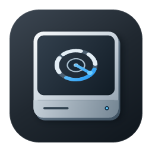
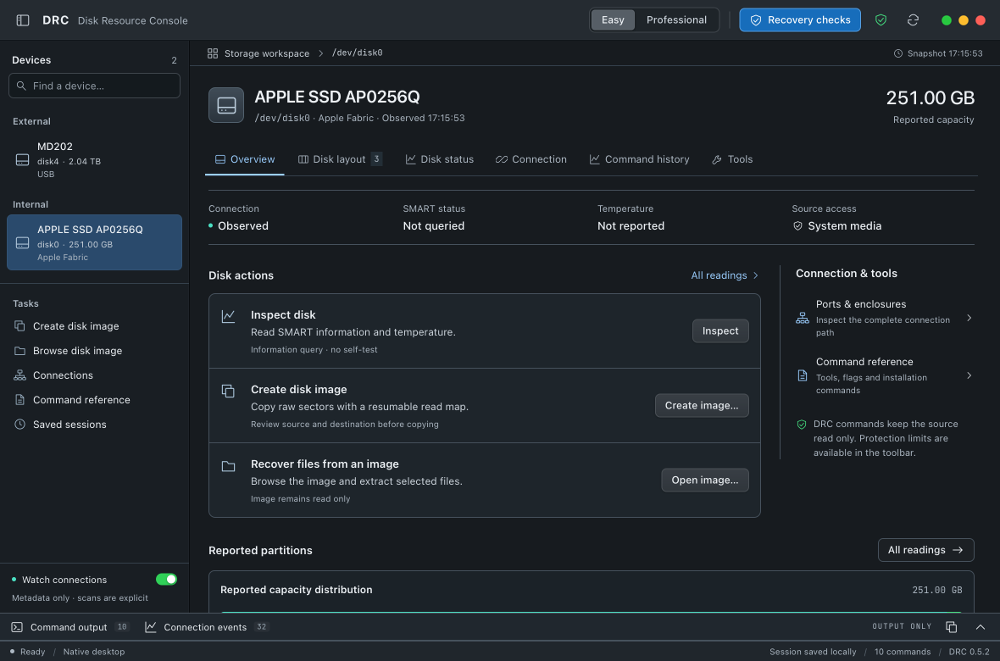
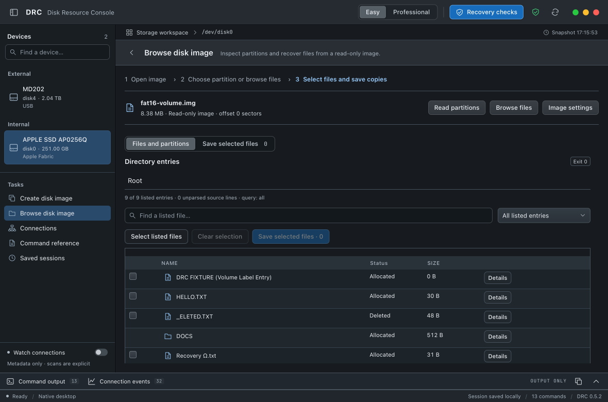
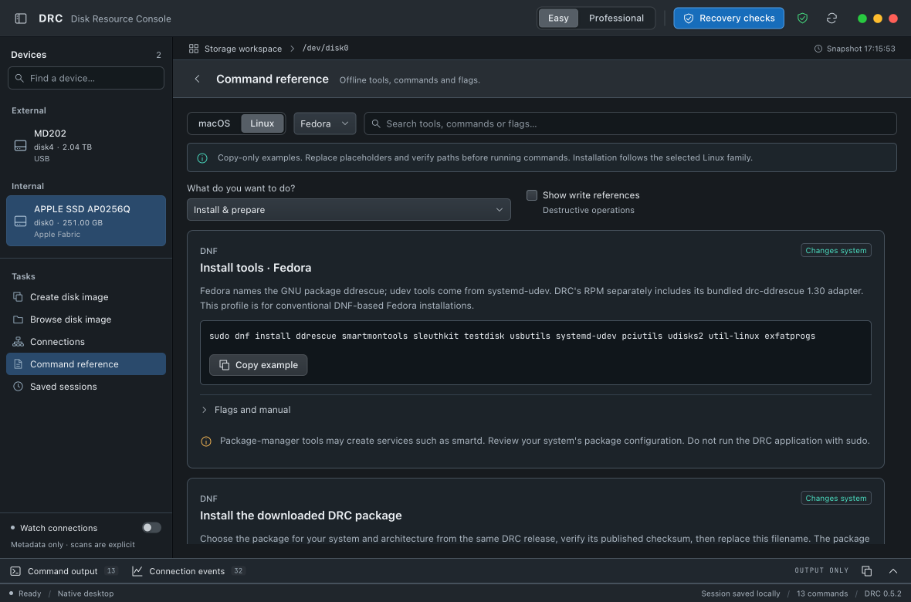

<div align="center">
  
  <h1>DRC</h1>
  <p><strong>Disk Resource Console</strong></p>
  <p>Disk inspection, raw imaging and file recovery.</p>
  <p>
    <a href="package.json"></a>
    <a href="#install"></a>
    <a href="docs/LINUX-INSTALL.md"></a>
    <a href="LICENSE"></a>
  </p>
  <p>
    <a href="src-tauri/Cargo.toml"></a>
    <a href="src-tauri/Cargo.lock"></a>
    <a href="package-lock.json"></a>
    <a href="package-lock.json"></a>
    <a href="src-tauri/build.rs"></a>
  </p>
  <p>
    <a href="https://github.com/m7md-d/DRC/releases/latest">Downloads</a> ·
    <a href="docs/RELEASE-NOTES.md">Release notes</a> ·
    <a href="docs/LINUX-INSTALL.md">Linux installation</a> ·
    <a href="LICENSE">GPL v3</a>
  </p>
</div>

## Functions

- Connected disks, partitions, SMART/NVMe readings and original command output.
- USB, hub and enclosure tree, network interfaces and reported display-link states.
- Raw imaging with GNU ddrescue: mapfiles, stop/resume, rate charts and read-error counts.
- Image browsing and selected-file extraction through Sleuth Kit.
- Local sessions and a command reference for macOS, Debian-family Linux and Fedora.
- Native macOS menu bar panel for CPU, memory, disks and ports.

Easy uses copy steps, a file browser and connection cards. Professional exposes complete tables and parameters. Changing mode preserves the current task, entered values and selections. Both modes retain original readings and source protections.

## Screenshots

### Disk overview



Device capacity, connection readings and inspection or imaging controls.

### Image files



Allocated and deleted entries read from a generated FAT16 image through the normal image reader.

### Command reference



Linux installation commands, tool flags and copyable examples.


## Install

**Linux:** download the `.deb` or `.rpm` for your architecture and verify `SHA256SUMS`. See [installation commands](docs/LINUX-INSTALL.md). Run the application as a normal desktop user.

**macOS:** build locally with Node.js, Rust, Xcode command-line tools and Homebrew:

```sh
brew install smartmontools sleuthkit
npm ci
npm run desktop:build
```

Open `DRC.app` in the project root. The local bundle is ad-hoc signed; it is not notarized. The image reader and GNU ddrescue are bundled. SMART queries use the separately installed smartmontools.

## Source access

DRC opens sources read-only. Imaging and extraction write to a reviewed destination. Mounted and system disks are excluded from physical acquisition. DRC does not provide system-wide or hardware write blocking.

On macOS, opening a raw source can request administrator authorization and require Full Disk Access. The app and copy process stay unprivileged; the authorized helper opens only the reviewed source for reading. Rebuilding an ad-hoc signed app can require renewing its privacy permission.

USB power budgets are reported metadata, not measured electrical consumption. A device without readable storage access cannot be imaged. NTFS/exFAT reader support depends on Sleuth Kit; the generated recovery test corpus currently covers FAT16/MBR.

Windows is not implemented. Details: [source protection](docs/SAFETY_MODEL.ar.md), [tested scope](docs/BUILD_CHECKS.md), [SSD failure handling](docs/SSD-RESILIENCE.md).

## Development

Rust backend, Tauri desktop shell, React/TypeScript workspace and SwiftUI/AppKit macOS monitor.

```sh
npm test
npm run native:test
npm run rust:test
npm run rust:check
npm run desktop
```

[Release and screenshot scripts](docs/RELEASING.md) · [Writing rules](docs/COPY-STYLE.md) · [Interface design](docs/DESIGN.md)
